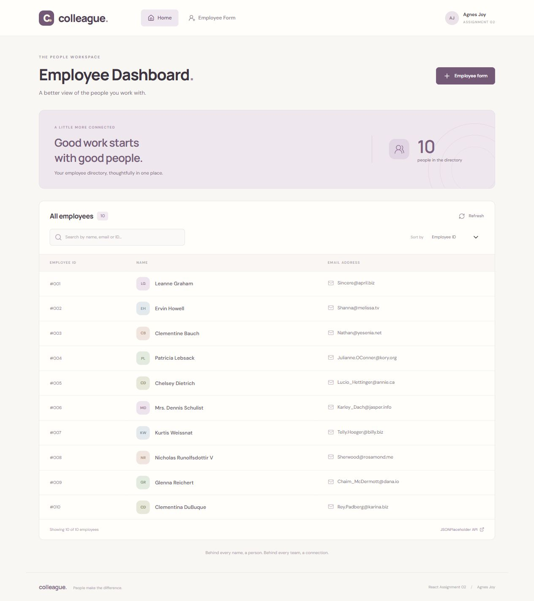

# Colleague — Employee Dashboard

**Assignment 2**

**Student: Agnes Joy**

A standalone React employee dashboard with a searchable directory, sorting and a separate employee form. Built with **React**, **React Router**, **Bootstrap 5**, **Vite**, and **Lucide React**. The cream-and-plum interface is designed for this assignment.

**Submission repository:** https://github.com/agnesjoyjacob15-byte/employee-dashboard



## Run locally

Requires Node.js **22.12 or later** and npm. Open a terminal in this project folder:

```sh
npm ci
npm run dev
```

Open the URL printed by Vite.

```sh
npm run build    # Build the production app into dist/
npm run preview  # Preview the compiled app
```

## Requirement mapping

| Assignment requirement | Implementation |
| --- | --- |
| React employee dashboard | Functional components and React hooks |
| Navbar with Home and Employee Form | Shared navigation with active route styling |
| External API data on Home | GET https://jsonplaceholder.typicode.com/users |
| ID, name and email | Responsive employee table |
| Name, Designation, Location and Salary | Four labelled, required form fields |
| Routes between the two pages | `/#/` and `/#/employee-form` |
| Any CSS library | Bootstrap 5 imported from npm |
| No frontend POST required | Form only previews details in React state |

HashRouter keeps navigation and refreshes working on static hosts without server rewrite rules. The public JSONPlaceholder sample users are displayed as employees. Form values are not saved, posted, or added to that directory. Leaving the form clears its values.

## Features

- Search by name, email or ID.
- Sort by employee ID, name A–Z or name Z–A.
- Loading, empty, failure, timeout and retry handling; manual API refresh.
- Required fields, whitespace rejection, and nonnegative salary validation.
- Monthly salary in INR, with up to two decimal places.
- Employee preview and reset actions, entirely in the browser.
- Labelled controls, keyboard focus, route focus management and a skip link.
- Responsive layout and a horizontally scrollable table on small screens.

Internet access is needed for the API. Google Fonts is optional, with local fallback fonts.

## Source structure

```text
public/favicon.svg
src/
  main.jsx                 React entry and Bootstrap import
  App.jsx                  Navbar, footer and routes
  styles.css               Responsive custom styling
  pages/Dashboard.jsx      API directory, search and sorting
  pages/EmployeeForm.jsx   Validated form and local preview
```

## Manual verification

See [completed verification results](docs/VERIFICATION.md), the [employee form](docs/employee-form.png), and the [mobile form screenshot](docs/mobile-form.png).

1. Open Home and check that every employee has an ID, name and email.
2. Search for a name, email and ID; test an unmatched search and clear it.
3. Test all three sorting options and the Refresh action.
4. Open Employee Form; test required fields, whitespace-only text and a negative salary.
5. Enter valid details and choose **Preview employee**; verify all four values.
6. Edit a field to clear the old preview; choose **Reset** to clear the form.
7. Navigate between both routes and refresh each URL.
8. Check the layout on a phone; scroll the table horizontally when necessary.
9. Test the error and retry state when the external API is unavailable.

## References

- [JSONPlaceholder users API](https://jsonplaceholder.typicode.com/users)
- [React Router documentation](https://reactrouter.com/start/declarative/installation)
- [Bootstrap documentation](https://getbootstrap.com/docs/5.3/getting-started/introduction/)

Submit this project's GitHub repository URL for Assignment 2.
